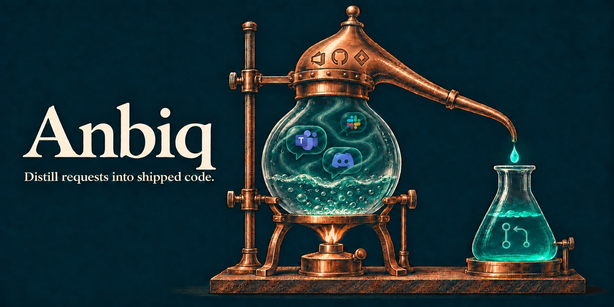

# Anbiq

<p align="center">
  
</p>

Anbiq is an open-source software factory. You send a request from the chat app you already use (Slack, Microsoft Teams, WhatsApp, and more). Anbiq turns it into a tracked job, and coding agents plan, build, test and review it. You get a pull request back in the same conversation. Nothing is merged or deployed until you say so.

> **Status: design phase.** Nothing here is usable yet. The architecture and roadmap are public so the design can be discussed before the code exists. Watch the repo or open an issue if you want to shape it.

**Anbiq** (an-BEEK), from Arabic _al-anbīq_ (الأنبيق), the alchemist's still that became the "alembic".

## How it works

A still has four parts, and so does Anbiq:

| Part of the still                                | In Anbiq                                                                                |
| ------------------------------------------------ | --------------------------------------------------------------------------------------- |
| **Cucurbit**: the pot where the raw mix goes in  | **Intake**: requests arrive from any connected chat app and become jobs in your tracker |
| **Head**: where the vapour rises and separates   | **Crews**: agents work each job in stages, from spec to build to QA to review           |
| **Beak**: the spout the distillate runs out of   | **Pull request**: tested, reviewed and described, posted back to your conversation      |
| **Receiver**: the flask that collects the result | **Merge and deploy**: only when you reply with an explicit command                      |

```
 chat app ──► tap ──► core ──► tracker issue ──► runner (agents: spec → build → QA → review)
    ▲                   │                                   │
    └── replies ◄───────┴──── events ◄──────────────────────┘
                        └──► live board
```

## Principles

- **A person approves every merge and every deploy.** Agents open pull requests; humans decide what ships.
- **Agents never see deploy credentials or production data.** The agent's job runs with the least access that can still do the work.
- **Your tracker and git host are the source of truth.** Every job is an issue and every change is a pull request, so the whole history stays where your team already looks.
- **Everything is a module.** Chat apps, trackers, git hosts, runners and agent engines plug in behind small interfaces. Swap them by configuration, not by forking.
- **Start slow.** One trigger at a time, hard caps on cost, turns and time, and a kill switch that stops everything at once.

## Modules

| Slot               | First implementation                                             | Planned                                     |
| ------------------ | ---------------------------------------------------------------- | ------------------------------------------- |
| Tap (chat channel) | Slack, WhatsApp (via Twilio), Telegram, Discord, Microsoft Teams | email; iMessage as experimental             |
| Tracker            | GitHub Issues                                                    | Linear, Jira                                |
| Git host           | GitHub                                                           | GitLab                                      |
| Runner             | GitHub Actions                                                   | self-hosted machine, hosted agent sandboxes |
| Agent engine       | Claude Code                                                      | other coding agents                         |
| Event sink         | Anbiq live board                                                 | OpenTelemetry                               |

See [docs/architecture.md](docs/architecture.md) for the interfaces, the job lifecycle and the security model, and [docs/crews.md](docs/crews.md) for what each crew does.

## Run it

Try the live board first, with the real factory and a simulated outside world (no accounts or keys needed):

```sh
npx @anbiq/server --demo   # then open http://localhost:8080/board
```

Anbiq runs as one small container with a SQLite file. [docs/deploy.md](docs/deploy.md) walks through the GitHub App, the crew workflow, `anbiq.yml`, the environment and the webhook URLs.

Every module is also published on npm under [`@anbiq`](https://www.npmjs.com/org/anbiq):

```sh
npm install --global @anbiq/server   # the server, as the anbiq-server command
npm install @anbiq/core @anbiq/tap-slack @anbiq/github   # or build your own factory from the parts
```

## Roadmap

The roadmap lives in [issues](../../issues). In short:

1. **Bootstrap:** monorepo, CI, the core job model and the configuration file.
2. **One tap, one runner:** Slack in, GitHub Actions running Claude Code, a pull request back in the thread.
3. **A second tap:** WhatsApp, to prove the channel interface is not shaped by Slack.
4. **Approvals:** `merge`, `revise`, `deploy`, `status`, `cancel`, with per-project policy.
5. **Live board:** watch every job and every agent as it works.

## Contributing

Early contributions are most useful as design feedback in issues. See [CONTRIBUTING.md](CONTRIBUTING.md). Report security problems privately, as described in [SECURITY.md](SECURITY.md).

## License

[MIT](LICENSE) © 2026 Diyar Faraj
